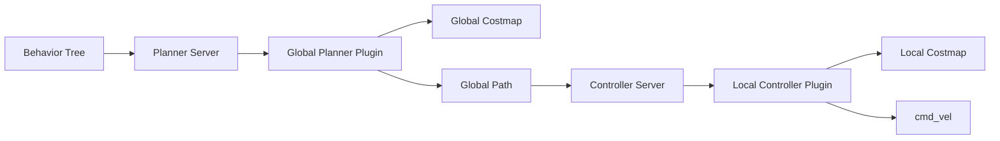

# Nav2 导航算法学习型注释工作流

本技能用于持续整理 Nav2 导航栈的源代码，使代码注释同时承担“维护说明”和“学习教材”的作用。目标不是翻译每一行代码，而是逐步解释全局规划、局部控制、代价地图、生命周期、插件加载以及模块之间的数据流和控制流。

默认不处理 `nav2_amcl`，除非用户明确指定。用户要求“继续”时，应直接选择下一个尚未充分解释的导航模块继续处理，不重复询问用户意见。

## 必须遵守的边界

- 不删除、重排、改写或格式化业务代码。
- 不删除原有英文注释、许可证头、Doxygen 文档或 TODO。
- 只新增中文解释性注释；中文注释应紧邻函数、状态转换或关键算法块。
- 不为了加注释修改参数默认值、控制流、异常类型、消息字段、插件注册或线程模型。
- AMCL 默认排除在处理范围之外。
- 同一 ROS 2 API、参数机制或基础概念只在第一次出现处详细解释；后续位置解释本地特殊用途即可。
- 不在普通变量赋值、单行函数调用和机械重复的条件前堆叠低信息量注释。
- 注释必须明确区分“代码实际做了什么”和“算法通常如何理解”，不能凭空补充代码中不存在的行为。

## 处理范围和优先级

按以下优先级逐步推进：

1. 导航主干接口和服务端：`nav2_core`、Planner Server、Controller Server。
2. 代价地图：`Costmap2DROS`、`LayeredCostmap`、插件层、过滤器、footprint 和碰撞检查。
3. 全局规划器：NavFn、SMAC、Theta*、Nav2 Route、平滑器和路径后处理。
4. 局部控制器：Regulated Pure Pursuit、DWB、MPPI、Rotation Shim、Graceful Controller。
5. 行为树导航、Waypoint Follower、速度平滑器和恢复行为。
6. 测试、辅助头文件和配置文件；只有在能准确解释结构时才处理 YAML、XML、launch、URDF 或 SDF。

优先处理直接决定算法行为的 `.cpp`，然后补齐其头文件契约、插件描述和相邻测试。不要为了追求覆盖率而大范围扫描无关包。

## 每个文件的工作方法

### 1. 建立局部假设

编辑前先找到一个直接控制行为的类、函数或逻辑块，并形成一个可被验证的局部判断，例如：

- Planner Server 负责调度插件，具体路径质量由 GlobalPlanner 实现决定。
- Controller Server 负责控制循环和失败策略，具体速度生成由 Controller 插件决定。
- LayeredCostmap 先收集各层更新边界，再按窗口合并成本。
- RPP 根据前视点曲率生成速度，随后叠加曲率、障碍距离、接近目标和碰撞预测约束。
- DWB 通过速度采样、轨迹仿真和 critics 评分选择控制命令。
- MPPI 通过批量控制序列采样、代价评估和优化更新产生控制命令。

同时确定一个便宜的反证检查：文件诊断、目标包文本检查、相邻测试、或者确认代码 diff 中只有注释变化。

### 2. 读取最小必要上下文

优先读取：

- 当前函数的声明和定义。
- 直接调用者或被调用的核心函数。
- 相关基类接口。
- 一个相邻插件或测试。
- 插件 XML 和参数配置，仅在解释插件类型或参数来源时读取。

如果当前文件只是转发或注册代码，应向最近的实际计算、状态变更或资源控制函数移动一层，而不是在转发处写大量算法说明。

### 3. 设计注释内容

函数级中文注释至少回答：

- 谁在什么时候调用它。
- 输入来自哪个模块、坐标系或消息。
- 函数如何改变状态、生成路径/速度/地图或管理资源。
- 成功、失败、取消、超时和异常时分别发生什么。
- 结果会被哪个下游模块消费。

关键算法块应解释：

- 数据结构代表什么，例如 open set、potential、轨迹样本、costmap layer、footprint。
- 状态如何从输入流向输出。
- 代价、启发式、曲率、速度、碰撞和时间预算如何共同影响结果。
- 为什么代码需要锁、TF、生命周期状态、动态参数或插件接口。
- 边界条件和失败路径，例如越界、目标在障碍中、路径为空、costmap 未更新或控制命令会碰撞。

保留英文注释，并在其上方或下方补充中文，不要把英文原意改写掉。

## 全局规划注释要求

对每个全局规划器说明完整流程：

1. Planner Server 如何选择插件并传入 start/goal。
2. 世界坐标如何转换为 costmap 栅格坐标。
3. 如何处理未知空间、障碍、目标容差和起终点边界情况。
4. 搜索或传播的状态、代价函数和终止条件。
5. 如何从内部结果恢复成 `nav_msgs::msg::Path`。
6. 是否进行平滑、插值、最终朝向修正或路径后处理。
7. 结果如何交给 Controller Server 和局部控制器。

至少区分以下算法思想：

- NavFn：势场传播和从势场回溯路径，可比较 Dijkstra 与 A*。
- SMAC：显式状态节点搜索、碰撞检查、代价/启发式和路径平滑。
- Theta*：A* 邻居扩展与 LOS 直线可见性、祖先父节点重连。
- 其他规划器：以代码实际使用的状态空间、代价和约束为准，不套用上述模板。

## 局部控制注释要求

对每个控制器说明完整闭环：

1. Controller Server 如何传入当前 pose、速度、全局路径和 GoalChecker。
2. 全局路径如何裁剪、转换到机器人坐标系并生成局部参考。
3. 控制器如何选择前视点、轨迹样本、控制序列或目标状态。
4. 如何计算线速度、角速度、曲率、轨迹代价和约束。
5. 如何做 footprint 碰撞检查、前瞻预测、超时和失败处理。
6. 输出如何发布到 `cmd_vel`，以及何时停止或抛出异常。

重点解释不同方法的差异：

- RPP：前视点、圆弧曲率和速度调节。
- DWB：速度空间采样、轨迹仿真、critics 评分和最优轨迹选择。
- MPPI：控制序列采样、批量代价评估、权重更新和滚动优化。
- Rotation Shim：方向对齐阶段与主控制器之间的状态切换。

## ROS 2 和 Nav2 API 说明规则

第一次遇到以下概念时，使用“机制 + 当前代码作用 + 参数/状态含义 + 应用影响”的结构进行完整说明：

- LifecycleNode 和 configure/activate/deactivate/cleanup。
- `declare_parameter`、参数读取、动态参数回调和参数生效时机。
- Action Server 的 goal、cancel、feedback、result 和抢占。
- `tf2_ros::Buffer`、TransformListener、frame、时间戳和 transform tolerance。
- pluginlib 类加载、插件描述文件、类型字符串和失败处理。
- Costmap layer、filter、rolling window、update bounds 和 footprint。
- Publisher、Lifecycle Publisher、QoS 和控制命令发布时机。
- 互斥锁、callback group、executor 和控制循环线程安全。

单位按代码和消息定义确认：距离通常为 m，线速度为 m/s，角速度为 rad/s，角加速度为 rad/s²，时间为 s，频率为 Hz；无法从当前上下文确认的单位要明确写成待核实，不得臆测。

## 保存跨模块逻辑和交互关系

仅靠源文件注释不足以表达完整导航链路。每完成一个主干模块或算法族，都要维护一份工作区文档：

- 默认路径：`doc/development/nav2_annotation/`。
- 总览文档：`doc/development/nav2_annotation/navigation_flow.md`。
- 算法文档可按主题拆分，例如：
  - `global_planners.md`
  - `local_controllers.md`
  - `costmap_pipeline.md`
  - `lifecycle_and_plugins.md`

文档内容至少包括：

- 模块职责和输入/输出。
- 调用关系和数据流。
- 全局规划与局部控制的边界。
- costmap 如何被 planner/controller 共享。
- 生命周期和插件装载顺序。
- 关键异常、失败、取消和停止路径。
- 已完成注释的文件和未处理的文件。
- 术语表以及重复 API 的首次详细解释位置。

使用 Mermaid 表达稳定的模块关系或控制流，例如：

文档只能记录已从代码确认的关系。若调用关系或线程模型尚未确认，标记为“待核实”并记录需要查看的文件。

## 编辑和验证顺序

每一批只处理少量相关文件：

1. 先读取上下文并记录局部假设。
2. 进行最小的注释插入，保留代码和英文注释的原有顺序。
3. 第一时间执行窄范围验证：文件诊断、目标包测试、语法/格式检查或文本 diff。
4. 若验证支持当前假设，只修复同一文件中的注释问题，再重复相同验证。
5. 若验证推翻假设，只向直接控制行为的相邻函数移动一层，不重新扫描整个仓库。
6. 更新跨模块学习文档，再处理下一批。

推荐验证内容：

- 编辑文件的语言服务诊断。
- `git diff --check` 检查空白和注释格式。
- 确认业务代码行没有被删除、重排或改写；必要时只比较非注释行。
- 目标包存在测试时运行最窄的相关测试。
- C++ 依赖环境完整时执行目标包编译；若环境缺少 ROS 2 include 或依赖，只记录为环境限制，不把它误报为注释引入的语法错误。

## 完成标准

- 目标文件的中文注释覆盖主要生命周期、接口、算法和失败路径。
- 原有代码、英文注释、许可证和 Doxygen 内容仍然存在。
- 关键模块的调用链和交互关系已保存到 `doc/development/nav2_annotation/`。
- AMCL 未被误处理，除非用户明确指定。
- 高频 ROS 2 API 没有被逐处复制解释。
- 中文注释说明原因、输入、状态变化、输出和下游使用，而不是只翻译函数名。
- 诊断或目标包验证有新鲜结果；环境问题与代码问题分开报告。
- 最终摘要列出本批文件、保存的流程文档、验证结果和剩余范围。

## 触发示例

- “继续注释 Nav2 的全局规划和局部控制代码，并把模块交互流程保存到文档。”
- “按导航算法学习型注释工作流处理这个包，保留英文注释，AMCL 不处理。”
- “梳理 Planner Server、Controller Server、Costmap 和插件之间的数据流，同时只添加注释和学习文档。”
