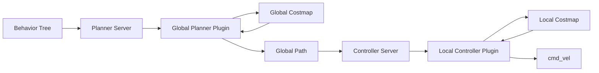

# Nav2 导航主流程学习笔记

本文档记录 Nav2 导航代码注释过程中确认的模块职责、调用链和算法交互关系。它与源文件中的中文注释配套使用：源文件解释局部实现，本文档解释跨模块关系。

## 总体数据流

## 模块职责

### Costmap2DROS 和 LayeredCostmap

`Costmap2DROS` 是代价地图生命周期节点，负责读取地图参数、创建 TF、加载 layer/filter 插件、配置机器人 footprint，以及启动地图更新和发布资源。

`LayeredCostmap` 负责真正组织多层成本：

- `StaticLayer` 提供静态地图或地图服务器数据。
- `ObstacleLayer` 根据传感器观测写入动态障碍。
- `InflationLayer` 将障碍成本扩散到周围区域，给规划器和控制器留出安全距离。
- Costmap filter 在基础插件完成后对最终地图做后处理。

更新周期大致为：

1. 各 layer 通过 `updateBounds()` 报告本轮需要刷新的世界坐标区域。
2. `LayeredCostmap` 把世界坐标边界转换成栅格索引并限制在地图范围内。
3. 清空目标窗口。
4. 按插件注册顺序调用 `updateCosts()`。
5. 没有 filter 时直接得到 `combined_costmap_`；有 filter 时先写入 `primary_costmap_`，复制到最终地图后再应用 filter。
6. Planner 或 Controller 从最终成本地图读取障碍、未知区域和代价信息。

全局地图通常用于长距离规划，局部地图通常使用 rolling window 跟随机器人。两者都遵循相同的 layered costmap 机制，但范围、更新频率和用途不同。

### Planner Server 和全局规划器

Planner Server 负责 Action 接口、请求取消/抢占、起点终点获取、插件选择、路径结果封装和失败返回。它不决定具体搜索算法，而是通过 `nav2_core::GlobalPlanner` 接口调用插件的 `createPlan()`。

全局规划链路为：

1. 上层行为树向 Planner Server 发送目标或路径请求。
2. Planner Server 选择 planner ID，并确认 costmap 可用。
3. Planner 插件把世界坐标转换为 costmap 栅格坐标。
4. 插件在全局成本地图上搜索、传播或优化。
5. 插件将内部节点转换成 `nav_msgs::msg::Path`。
6. 结果返回给行为树和 Controller Server。

当前已整理的算法差异：

- **NavFn**：在栅格上计算势场，使用 Dijkstra 或 A* 传播代价，再沿势值下降方向回溯路径；目标不可达时可以在 tolerance 范围内寻找合法落点。
- **SMAC 2D**：显式扩展网格状态，使用 A*、碰撞检查器和代价/启发式搜索，再对离散路径做平滑。
- **Theta***：在 A* 邻居扩展基础上使用 LOS 检查，若当前节点能直接看到祖先节点，则可以重连父节点并减少不必要的网格拐角。

### Controller Server 和局部控制器

Controller Server 负责控制 Action、控制循环、插件选择、GoalChecker、ProgressChecker、速度发布、取消处理和控制失败策略。具体的速度计算由 `nav2_core::Controller` 插件完成。

局部控制链路为：

1. Controller Server 接收全局路径和当前机器人状态。
2. Controller 插件将路径转换到机器人坐标系，或者选择局部路径窗口。
3. 插件根据当前 pose、速度、代价地图和目标状态计算候选控制命令。
4. 插件进行曲率约束、轨迹评分、速度约束和 footprint 碰撞检查。
5. Controller Server 检查目标是否到达、机器人是否仍在前进，以及命令是否有效。
6. 合法速度发布到 `cmd_vel`；取消、失败或完成时发布停止命令。

当前已整理的控制算法差异：

- **Regulated Pure Pursuit**：在机器人坐标系中选择前视点，通过前视点横向偏移计算曲率；根据转弯半径、障碍成本、接近终点距离和碰撞预测降低线速度。
- **DWB**：在速度空间采样多个速度，仿真每个速度产生的轨迹，再由多个 critics 评分并选择最优轨迹。
- **MPPI**：围绕控制序列采样大量候选轨迹，批量计算代价，通过权重更新控制序列，最后执行滚动优化得到当前速度。
- **Rotation Shim**：在调用主控制器前先判断机器人是否需要原地对齐路径方向；完成对齐后再把控制权交给主控制器。

### Waypoint Follower 和到点任务插件

`WaypointFollower` 位于完整导航目标和单点导航目标之间，负责把一个包含多个 Pose 的 `FollowWaypoints` 请求拆成多个连续的 `NavigateToPose` 请求。

其状态流为：

1. 接收外层 `follow_waypoints` goal，并从 waypoint 索引 0 开始。
2. 通过 Action Client 向 `navigate_to_pose` 发送当前 waypoint。
3. 在等待异步结果期间发布当前 waypoint feedback。
4. `resultCallback()` 校验返回 goal ID，避免旧目标的延迟结果污染抢占后的新目标。
5. 导航成功后调用 `WaypointTaskExecutor::processAtWaypoint()` 执行到点任务。
6. 根据 `stop_on_failure` 处理导航失败或到点任务失败：终止整个请求，或记录失败索引并继续。
7. 所有 waypoint 完成后返回结果，其中 `missed_waypoints` 保存未成功处理的索引。

`WaypointTaskExecutor` 是一个 pluginlib 插件接口。它可以创建自己的 publisher、subscriber 或 service client，但不负责移动机器人；移动仍由 `NavigateToPose` Action 和下游导航栈完成。这样可以把“走到点”和“到点后做什么”解耦，例如等待、拍照、触发 IO 或执行自定义业务动作。

当前 waypoint follower 包中的示例插件体现了三种任务模式：

- `WaitAtWaypoint`：读取毫秒级暂停时间，在到点任务中同步等待；时间为 0 或插件禁用时直接返回成功。
- `PhotoAtWaypoint`：持续订阅相机图像并缓存最新帧，到点时在互斥锁保护下复制图像、转换为 OpenCV Mat 并写入指定目录；目录创建、图像转换或写盘失败会返回失败。
- `InputAtWaypoint`：订阅 `std_msgs::msg::Empty`，到点后清除旧标志并以固定频率等待新的外部输入；超过秒级 timeout 返回失败，避免任务序列永久阻塞。

这些插件都通过 `processAtWaypoint()` 的布尔返回值与 `stop_on_failure` 连接起来，因此“到点任务失败”与“导航到点失败”最终具有一致的上层处理策略。

取消和抢占的优先级高于当前 waypoint 的正常处理：取消时先取消下游导航目标，再终止外层 Action；抢占时接受新 goal、重置 waypoint 索引并从新列表重新开始。

## 关键交互边界

### 全局规划与局部控制

全局规划器解决“从起点到目标经过哪些区域”，输出相对稀疏或经过平滑的参考路径。局部控制器解决“当前这一周期应该发布什么速度”，只处理机器人附近的路径窗口和实时障碍。

全局规划通常不直接输出速度，局部控制器通常不重新规划完整地图路径。二者通过 `nav_msgs::msg::Path` 和共享的 costmap/TF 信息连接。

### Costmap 与规划/控制

- Global Planner 主要依赖全局 costmap 判断长距离可达性。
- Local Controller 主要依赖局部 costmap 做实时障碍和 footprint 检查。
- Planner/Controller 读取地图时需要遵守 costmap 锁，避免更新线程与读取线程产生不一致。
- `NO_INFORMATION` 是否可通行由 `allow_unknown`、costmap 默认值和具体插件策略共同决定。

### TF 与坐标系

典型坐标关系为：

- 全局路径通常在 `map` 或 `odom` frame 中。
- 机器人当前姿态来自定位/里程计，并通过 TF 转换到目标 frame。
- 局部控制器通常需要把路径转换到 `base_link` 或 costmap 的 robot base frame。
- transform tolerance 用于容忍传感器或 TF 发布延迟；过小会频繁变换失败，过大可能使用过期姿态。

## 生命周期和插件装载

典型顺序如下：

1. Lifecycle node 构造时声明公共参数和插件参数。
2. `on_configure()` 创建 costmap、TF、publisher、subscription、plugin loader 和插件实例。
3. 每个插件执行 `configure()`，保存 node、costmap、TF 和参数。
4. `on_activate()` 激活 lifecycle publisher 和动态参数回调。
5. 运行期间 Planner Server 或 Controller Server 调用插件接口。
6. `on_deactivate()` 停止发布和动态参数更新。
7. `on_cleanup()` 释放插件、线程、publisher、costmap 缓存等资源。

插件 XML 中的类名字符串必须与 `pluginlib` 加载的 C++ 类型一致。配置错误通常在插件创建或参数读取阶段暴露，而不是在第一次规划时才出现。

## 已完成与后续范围

当前已添加或扩展中文注释的重点文件包括：

- `nav2_core` 的 GlobalPlanner/Controller 接口。
- `nav2_costmap_2d` 的 `Costmap2DROS` 和 `LayeredCostmap`。
- `nav2_planner` 和 `nav2_controller` 服务端主流程。
- `nav2_navfn_planner`、`nav2_smac_planner`、`nav2_theta_star_planner`。
- `nav2_regulated_pure_pursuit_controller`。
- 之前已经处理的 DWB、MPPI 和 Rotation Shim 核心实现。

后续继续按以下方向逐文件推进：

- DWB trajectory generator、critics 和 local planner 的完整评分链路。
- MPPI optimizer、path handler、批量轨迹评估和可视化。
- Rotation Shim 与主控制器之间的状态切换细节。
- Costmap layer/filter 的具体实现和插件之间的数据依赖。
- 行为树导航节点、Waypoint Follower、速度平滑器和恢复行为。

AMCL 默认不属于本注释范围。
